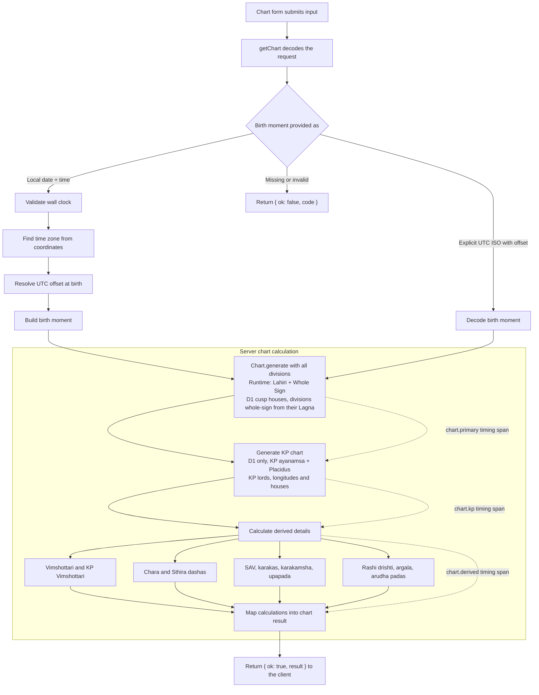

# Chart generation flow

The main chart and KP chart are calculated in sequence. Derived calculations use their results afterward.

The `chart.total` span covers the server-side calculation request. Optional derived calculations that fail are represented as absent in the result rather than failing the whole chart.

Every failure reaches the client as a `ChartErrorCode` (see `src/lib/chart-errors.ts`), never as prose: birth-moment problems keep their own code, and engine failures become `calculationFailed` after being logged on the server. The client chooses the copy for each code.
